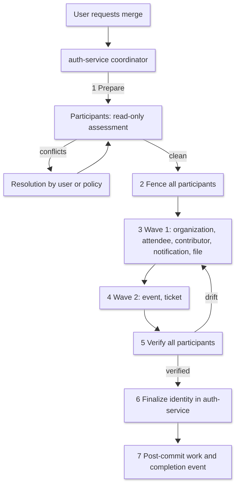
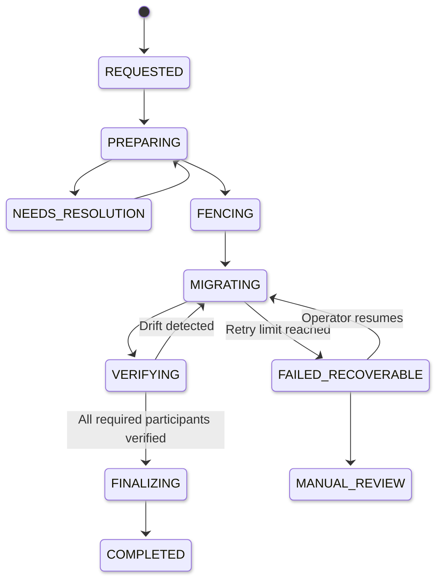
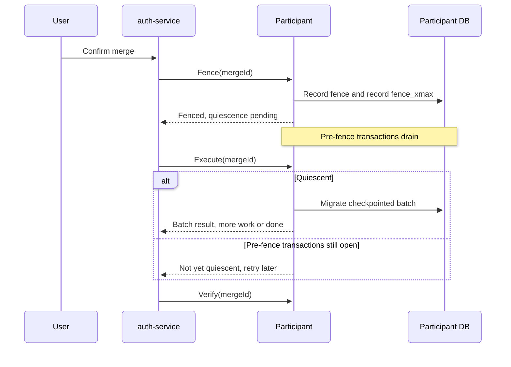

Account merging looks like a small feature: a user created two accounts by signing in with two identity providers, and wants one. In a microservices platform it is a distributed consistency problem, because the data for those two accounts is spread across independently deployed services that share no transaction.

This post is a design case study from [AttendOnTime](https://attendontime.com), the event platform described in [Building AttendOnTime](/blog/building-attendontime). It is written for backend engineers and architects who own service boundaries. The architecture and participant contracts are under construction; the full orchestration, the remaining service migrations, and the recovery tests are still planned. Nothing here reports production metrics, and the failure modes are anticipated, not observed.

## TL;DR

- An account merge is a coordinated workflow with durable state, not an identity-table update.
- A write fence on every participant, combined with a transaction-quiescence check, is what keeps concurrent writes from escaping the migration.
- Before the fence the merge can be cancelled cleanly. After it, recovery moves **forward only**.

## The Problem: One Person, Two Accounts

A user signs up with Google, later signs in with Microsoft, and unintentionally creates a second account. One account owns an organization, event memberships, and contributor information. The other holds event registrations, tickets, files, and notification preferences.

To the user these are one person. To the platform they are two accounts with independent identifiers, credentials, sessions, permissions, and data.

The constraint is that each service owns its own database and business rules. No single transaction spans them, so a partial migration can leave some records on the surviving account and others on the retired one. If the design were a naive identity update, the platform would silently orphan data or split a user's authorization across two identities.

> **The question:** how do you consolidate two identities across independently deployed services without losing data, weakening authorization, or leaving the platform inconsistent?

## Terminology

| Term | Meaning |
|---|---|
| Source account | The account being retired |
| Target account | The surviving account |
| Coordinator | `auth-service`, the canonical identity authority that drives the merge |
| Participant | A domain service that migrates its own data |
| Fence | A participant-local boundary that rejects new source-owned writes |
| `mergeId` | The stable identifier of one merge workflow |

## Design Overview

## Before and After

| Aspect | Naive identity update | This design |
|---|---|---|
| Data movement | One update, or direct writes into other databases | Each service migrates its own data |
| Atomicity | Assumed | Explicitly absent, replaced by durable state |
| Concurrent writes | Ignored | Fenced, then verified |
| Conflicts | Last write wins | Explicit policy, user decision, or review state |
| Failure after partial progress | Undefined | Checkpointed, resumable, forward recovery |
| Async paths (Kafka, jobs, WebSocket) | Forgotten | Canonical identity at every entry point |

## 1. Invariants Come Before the API

Before designing orchestration, I fixed the invariants the merge must preserve.

**Ownership moves; history remains.** A field that represents current ownership follows the target account. A field that represents historical attribution keeps the original identity.

- A user's current attendee ownership moves to the target account.
- The actor recorded on an administrative action stays as the original actor.
- A historical check-in keeps its attribution.
- A ticket stays tied to the correct registration and payment history.

Replacing every occurrence of the source user ID would erase the difference between current ownership and historical fact.

**Each service owns its data.** The coordinator never writes to another service's tables. Participants implement the operations to inspect, prepare, migrate, and verify their own data, so domain rules stay where they belong.

**No silent data loss or privilege escalation.** Two accounts might hold memberships in the same organization with different roles, or duplicate registrations for the same event. The wrong automatic choice could discard data or grant elevated permissions. Every conflict must end in an explicit policy outcome, a user decision, or a recoverable review state.

## 2. Coordinator and Participant Contract

`auth-service` is the coordinator. Domain services are participants. The contract has four operations, plus one for inspection:

| Operation | Responsibility | Mutates business data |
|---|---|---|
| `Prepare` | Report the data footprint and conflict codes | No |
| `Fence` | Reject new source-owned writes locally | No |
| `Execute` | Migrate data in repeatable, checkpointed batches | Yes |
| `Verify` | Confirm no unhandled source-owned records remain | No |
| `ListFences` | Inspect fence state for operators and recovery | No |

The abstraction is deliberately narrow. The coordinator manages progress and dependencies; participants enforce domain invariants. That lets heterogeneous services take part without sharing a schema.

### Decision: Orchestration over Choreography

**Options:**

- Central orchestrator with participant contracts
- Choreography, where each service reacts to a `MergeRequested` event
- A shared migration job that writes directly to every database

**Tradeoffs:**

- Orchestrator: one place for state, ordering, and escalation, but `auth-service` gains a coordination role and becomes a dependency of the merge.
- Choreography: loosely coupled, but wave ordering, fence confirmation, and "which participant is stuck" become hard to answer.
- Shared job: simplest to write, but it breaks service ownership and domain rules.

**Decision:** orchestrator.

**Implication:** the merge needs durable coordinator state and a recovery path for the coordinator itself, covered below.

## 3. The Merge Is a State Machine

A restart or a lost response must never leave the system unsure what happened, so the workflow has explicit durable states.

The diagram shows the principal path. Production handling also needs cancellation, transient failures, and operator-assisted recovery.

The key distinction is the fence boundary:

- **Before the fence**, the system can inspect, ask for decisions, and refuse the merge, with no business records migrated.
- **After the fence**, the workflow must account for partial execution. Recovery means continuing safely, not assuming a rollback.

## 4. Prepare Before Mutating

Preparation is a read-only assessment of both accounts. Each participant reports its footprint and supported conflict codes. Typical conflicts:

- Duplicate attendee registrations for the same event
- Memberships that collide under a unique constraint
- Conflicting contributor profiles
- Role combinations that need an explicit decision
- Data in a service whose migration is not yet implemented

The last case matters most. **A merge must be refused if a service holds source-owned data it cannot yet migrate safely**, even though the coordinator knows the service exists.

After a user resolves a conflict, the relevant check reruns. Immediately before fencing, the coordinator runs a final pass to reduce the chance of acting on stale assumptions. Preparation is a snapshot, so it does not eliminate races; the fence and verification do.

## 5. Fencing Concurrent Writes

Users and background processes keep writing while the merge is coordinated. A request that started before the merge boundary may commit a new source-owned record after migration has begun. Migrating only the records visible earlier would then leave an orphan.

Each participant therefore records a fence and installs a database-level write guard that rejects new source-owned writes. The coordinator waits until every required participant confirms its fence before any migration starts.

Transactions that began before the fence can still commit. The design records a transaction horizon, `fence_xmax`, and a participant must not execute until every transaction older than that horizon has finished (the quiescence condition).

The invariant is not that the application stopped sending writes to the source. It is that **no unaccounted source-owned write can escape migration and verification**.

> **Caution:** transaction-horizon semantics, isolation levels, trigger behavior, and alternate write paths all affect whether this holds. A diagram states the invariant; only the implementation and concurrency tests establish it.

### Decision: Write Fence over Optimistic Verify-and-Retry

**Options:**

- Fence writes, wait for quiescence, then migrate
- Migrate without a fence and rely on repeated verification passes
- Lock the source account globally for the duration

**Tradeoffs:**

- Fence: strongest guarantee, but source writes are rejected during the merge window, and it needs per-service database support.
- Verify and retry: no write blocking, but a busy account may never converge, and late writes can still slip in after the final pass.
- Global lock: simple to reason about, but it requires a distributed lock service and couples every service to it.

**Decision:** fence, with verification as a second line of defense.

**Implication:** every participant needs a database guard and a quiescence check, and the user-visible cost is a brief period during which the source account cannot write.

## 6. Dependency-Aware Waves

Some participants depend on others. Organization membership changes produce member-ID mappings that the event service consumes. Attendee ownership changes produce attendee-ID mappings that the ticket service uses to reconcile denormalized user references.

| Wave | Participants | Reason |
|---|---|---|
| 1 | Organization, attendee, contributor, notification, file | Independent of each other; produce ID mappings |
| 2 | Event, ticket | Consume Wave 1 mappings |

The coordinator completes a wave before starting the next and passes mappings to downstream participants. This is more than a performance choice: it makes reconciliation order explicit and gives recovery a dependency graph to follow.

A participant's earlier success is not permanent proof. If verification finds drift, the affected participant and its dependents are reopened and reprocessed in dependency order.

> **Idempotent execution makes retries safe. Dependency-aware recovery makes the overall result consistent. Both are required.**

## 7. Retries and Partial Failure

A timeout does not say whether an operation failed. A participant may commit its transaction while the response is lost.

- `mergeId` is the stable workflow identifier.
- Participants track progress and execution checkpoints.
- The execute contract reports whether work remains, and stored responses allow replay after an ambiguous outcome.

Failures are classified:

| Failure | Handling |
|---|---|
| Transient infrastructure error | Retry with backoff |
| Conflict needing a decision | Enter the resolution path |
| Retry budget exhausted | `FAILED_RECOVERABLE`, resumable by an operator |

### Decision: Forward Recovery over Cross-Service Rollback

**Options:**

- Roll back every participant on failure
- Roll back only before execution; move forward afterward
- Compensate with inverse migrations

**Tradeoffs:**

- Full rollback: attractive in theory, but reversing migrated records can overwrite newer activity or violate domain rules.
- Rollback before execution only: safe because no business data has moved, but requires a hard boundary.
- Inverse migrations: double the migration code and still face the newer-activity problem.

**Decision:** before any participant executes, an operator may remove fences and cancel. After execution begins, recover forward.

**Implication:** `Execute` must be resumable and `Verify` must be trustworthy, because they are the only recovery tools once data has moved.

## 8. Finalization Is a Separate Consistency Boundary

When every required participant has migrated and verified, `auth-service` finalizes in one local transaction. It updates identity and role associations, re-points sessions, records the source-to-target mapping and audit data, deactivates the source account, stores the final event snapshot, and marks the merge complete.

That transaction is atomic only inside `auth-service`. Cache eviction, token handling, WebSocket closure, and event publication must still happen afterward.

The design stores the work still owed in the same transaction, so a crash after commit does not lose the intent. The stored event snapshot can be republished, and consumers deduplicate on `mergeId`. This is an outbox-style pattern: persist the state change and the intent to publish together, then deliver asynchronously.

A broker acknowledgement does not prove every consumer processed the event. Consumer retries, deduplication, and dead-letter handling remain separate responsibilities.

## 9. Identity Resolution Beyond HTTP

A source account ID can arrive through many paths:

- GraphQL and REST requests
- Internal gRPC calls
- Kafka messages and dead-letter replays
- WebSocket handshakes
- Scheduled and queued jobs

Each path needs a defined behavior for a merging or merged identity, with canonical identity handling at the entry point and database guards as the last line of defense.

Authorization needs special care. A request tied to the source account must not keep exercising stale source permissions after the merge boundary; the target account's current authorization governs. Access tokens, refresh tokens, cached roles, and WebSocket connections expire on different schedules, so deactivating the source record does not instantly invalidate them.

Background jobs are the quiet risk. A job can load an old user ID, wait in a queue, and act on it long after the originating request. **A merge that is correct on the synchronous path can still fail operationally on an asynchronous one.**

## 10. Operations and Recovery

Architecture without operations is incomplete. The planned operational model:

- **Observability:** per-merge state, per-participant progress, fence age, and time spent in each state, keyed by `mergeId` in logs and traces.
- **Operator controls:** list fences, resume a recoverable merge, cancel before execution, and escalate to manual review.
- **Safe repetition:** every operator action must be documented as safe to repeat or not.
- **Disaster recovery:** restoring only the coordinator database could leave it disagreeing with participant fences or published events, so restore must run a reconciliation check across all three.
- **Cost:** the design reuses each service's existing database and the existing Kafka cluster. A fence is a row and a guard, not new infrastructure. Cost measurements will follow once the implementation is running.

### Planned Failure-Injection Tests

Each test asserts a specific invariant, not just that the workflow eventually succeeds.

| Scenario | Invariant checked |
|---|---|
| A transaction begun before the fence commits late | The late write is migrated or rejected, never orphaned |
| A participant commits a batch but the response is lost | Replay does not duplicate work |
| A completed participant is reopened after downstream work ran | Dependents are reprocessed in order |
| A completion event is delivered twice | The logical effect happens once |
| One post-commit step fails while others succeed | Only the failed step is retried |
| Restore yields inconsistent checkpoints or fence state | Reconciliation detects and reports the mismatch |

## Anti-Patterns

1. **Rewriting every user ID.** It destroys historical attribution.
2. **Reaching into another service's database.** It bypasses domain rules and couples deployments.
3. **Treating preparation as a guarantee.** It is a snapshot; only the fence closes the race.
4. **Designing rollback after data has moved.** It can overwrite newer activity.
5. **Fixing only the HTTP path.** Kafka consumers, jobs, and WebSockets keep acting on the old identity.
6. **Counting a broker acknowledgement as completion.** Consumers must still process and deduplicate.

## Tradeoffs Accepted

- The source account cannot write during the fenced window.
- `auth-service` takes on a coordination role and must itself be recoverable.
- Each participant must implement four contract operations plus a database guard.
- There is no automatic undo once execution begins.

## Key Takeaways

1. **Fix ownership and attribution rules before changing data.** Replacing IDs blindly erases history.
2. **Let each service migrate its own records.** Service boundaries are the reason the design is safe.
3. **Prepare and resolve conflicts before mutation.** Only the pre-fence phase can be cancelled cleanly.
4. **Fence writes and wait for quiescence.** A snapshot alone cannot stop late commits.
5. **Execute in dependency-aware waves.** Explicit order gives recovery something to follow.
6. **Make retries idempotent and progress durable.** A lost response must not change the outcome.
7. **Verify the distributed result before finalizing identity.** Finalization is atomic only locally.
8. **Treat post-commit delivery and operations as part of the design.** The completed transaction is not the end of the workflow.

## Status

The architecture and participant foundations are being built incrementally. The complete orchestration, the remaining service migrations, and the recovery testing are planned work. A sound design is a prerequisite for correctness, not proof that every failure mode is eliminated.

## Next Steps

This post is part of the AttendOnTime engineering series. Start with [Building AttendOnTime](/blog/building-attendontime) for the platform background, or [try AttendOnTime](https://app.attendontime.com).

Operations that look atomic to a user often cross boundaries that are not atomic internally. Reliability comes from explicit invariants and recoverable state transitions, not from assuming the happy path will complete.
