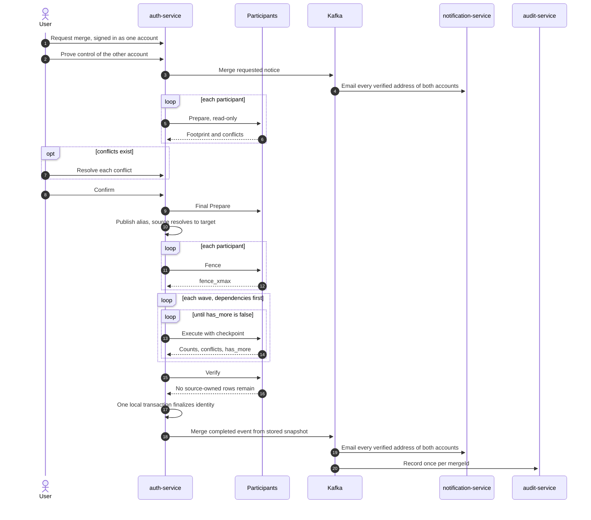
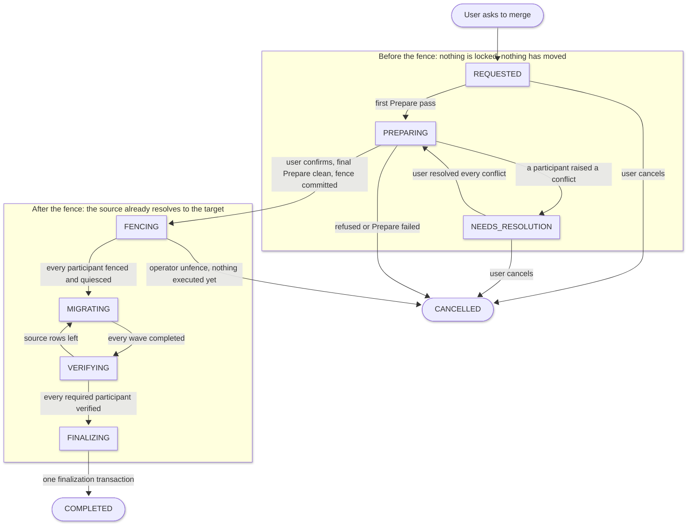
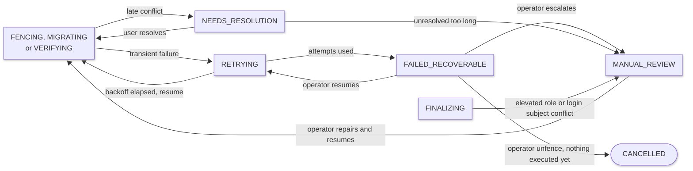
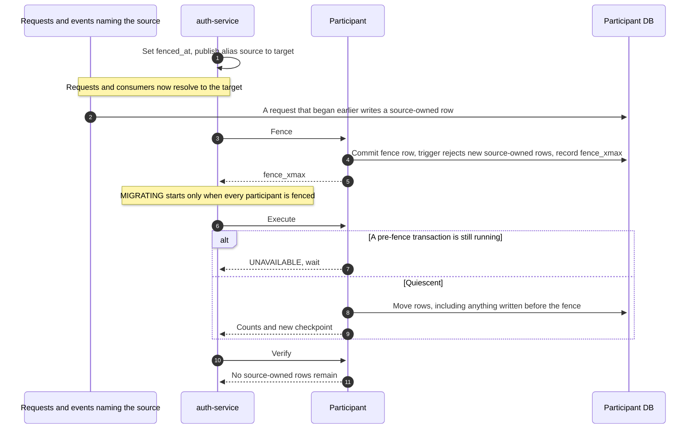
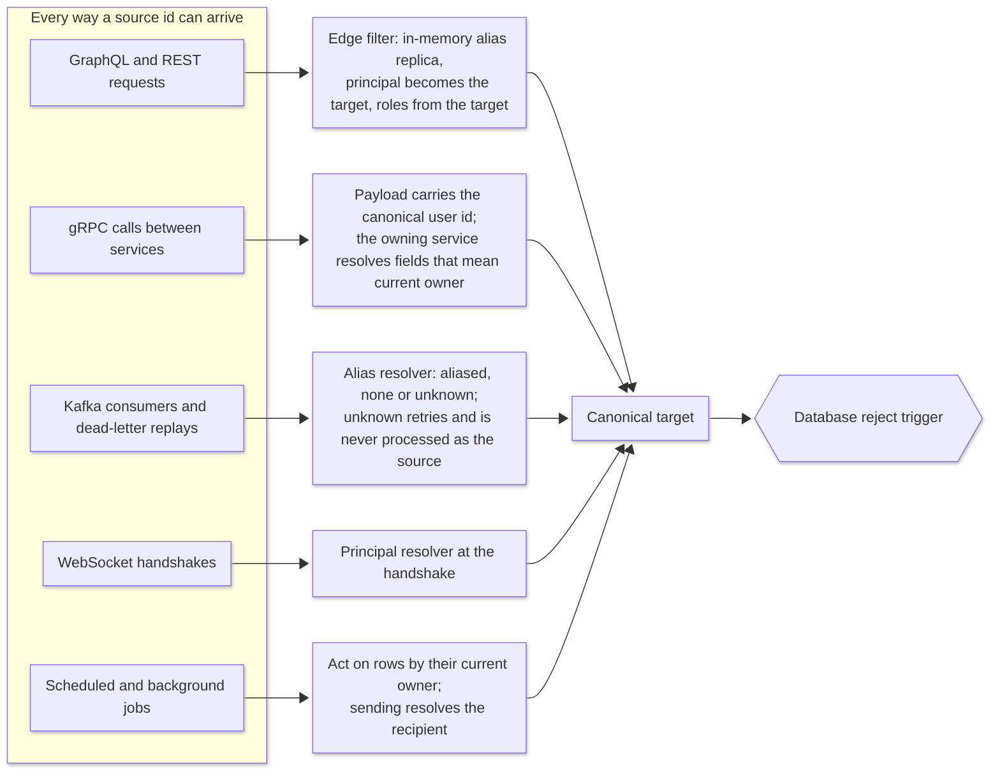

Account merging looks like a small feature: a user created two accounts by signing in with two identity providers, and wants one. In a microservices platform it is a distributed consistency problem, because the data for those two accounts lives in independently deployed services that share no transaction.

This post describes the account merge design for [AttendOnTime](https://attendontime.com), the event platform described in [Building AttendOnTime](/blog/building-attendontime). It is written for backend engineers and architects who own service boundaries. It covers the design decisions and the failure modes they address; it does not report production metrics.

## TL;DR

- An account merge is a coordinated workflow with durable state, not an identity-table update.
- A fence that makes the source account resolve to the target at every entry point, combined with a database write guard and a transaction-quiescence barrier, keeps concurrent writes from escaping the migration.
- Before the fence the merge can be cancelled freely. After data has moved, recovery goes **forward only**.

## The Problem: One Person, Two Accounts

A user signs up with Google, later signs in with Microsoft, and unintentionally creates a second account. One account owns an organization, event memberships, and contributor information. The other holds event registrations, tickets, files, and notification preferences.

To the user these are one person. To the platform they are two accounts with independent identifiers, credentials, sessions, permissions, and data.

The constraint is that each service owns its own database and business rules. No single transaction spans them, so a partial migration can leave some records on the surviving account and others on the retired one. A naive identity update would silently orphan data or split a user's authorization across two identities.

> **The question:** how do you consolidate two identities across independently deployed services without losing data, weakening authorization, or leaving the platform inconsistent?

## Terminology

| Term | Meaning |
|---|---|
| Source account | The account being retired |
| Target account | The surviving account |
| Coordinator | `auth-service`, the canonical identity authority that drives the merge |
| Participant | A domain service that migrates its own data |
| Fence | The point from which the source resolves to the target and participants reject new source-owned writes |
| `mergeId` | The stable identifier of one merge workflow |

## The Happy Path

The user initiates and confirms. After that, every step is driven by the coordinator; nothing polls on the user's behalf.

## Before and After

| Aspect | Naive identity update | This design |
|---|---|---|
| Data movement | One update, or direct writes into other databases | Each service migrates its own data |
| Authorization | Whoever holds a source token keeps source roles | Requests resolve to the target with the target's current roles |
| Atomicity | Assumed | Explicitly absent, replaced by durable state |
| Concurrent writes | Ignored | Aliased at the edge, guarded in the database, verified |
| Conflicts | Last write wins | Explicit policy, user decision, or review state |
| Partial failure | Undefined | Checkpointed, resumable, forward recovery |
| Async paths | Forgotten | Canonical identity at every entry point |
| Security of the request | Trust the session | Proof of both accounts, notice to every address |

## 1. Invariants Come Before the API

Before designing orchestration, I fixed the invariants the merge must preserve.

**Ownership moves; history remains.** A field that represents current ownership follows the target account. A field that represents historical attribution keeps the original identity.

- A user's current attendee ownership moves to the target account.
- The actor recorded on an administrative action stays as the original actor.
- A historical check-in keeps its attribution.
- A ticket stays tied to the correct registration and payment history.

Replacing every occurrence of the source user ID would erase the difference between current ownership and historical fact.

**Each service owns its data.** The coordinator never writes to another service's tables. Participants implement the operations to inspect, prepare, migrate, and verify their own data.

**No silent data loss or privilege escalation.** Two accounts might hold memberships in the same organization with different roles, or duplicate registrations for the same event. Every conflict must end in an explicit policy outcome, a user decision, or a recoverable review state. An elevated-role conflict at finalization goes to manual review, never to an automatic choice.

## 2. Coordinator and Participant Contract

`auth-service` is the coordinator. Domain services are participants. The contract has these operations:

| Operation | Responsibility | Mutates business data |
|---|---|---|
| `Prepare` | Report the data footprint, conflicts, and supported conflict codes | No |
| `Fence` | Commit a local fence and a write guard; return `fence_xmax` | No |
| `Execute` | Migrate data in repeatable, checkpointed batches | Yes |
| `Verify` | Confirm no source-owned rows remain | No |
| `Unfence` | Lift the fence while nothing has been executed | No |
| `ListFences` | Inspect fence state for operators and recovery | No |

The abstraction is deliberately narrow. The coordinator manages progress and dependencies; participants enforce domain invariants.

### Decision: Orchestration over Choreography

**Options:**

- Central orchestrator with participant contracts
- Choreography, where each service reacts to a merge-requested event
- A shared migration job that writes directly to every database

**Tradeoffs:**

- Orchestrator: one place for state, ordering, and escalation, but `auth-service` takes on a coordination role.
- Choreography: loosely coupled, but wave ordering, fence confirmation, and "which participant is stuck" become hard to answer.
- Shared job: simplest to write, but it breaks service ownership and domain rules.

**Decision:** orchestrator.

**Implication:** the merge needs durable coordinator state, a driver that resumes it after restarts, and its own recovery path.

## 3. A Merge Is a Security Event

Merging two accounts is also a path to account takeover, so the request is guarded before any data is examined.

- **Proof of both accounts.** The initiator proves a recent sign-in to the account they are using, and separately proves control of the other account through a step-up sign-in. Proofs expire after minutes, and confirmation rechecks them.
- **Notice to every address.** A request notice goes to every verified address of both accounts. Each recipient receives a one-time "this was not me" link.
- **A report stops the merge.** After the fence, a report parks the merge in manual review and blocks finalization until an operator releases it.
- **One active merge per account.** Concurrent merges involving the same account are refused.
- **A recommended survivor.** The system suggests which account to keep, and the user can switch before confirming.

### Decision: Proof of Both Accounts over Email Matching

**Options:**

- Step-up proof of both accounts
- Match on a shared verified email
- Support-assisted merges only

**Tradeoffs:**

- Both proofs: strongest assurance, but an extra sign-in step and no path for a user who lost access to one account.
- Email matching: frictionless, but a recycled or compromised address becomes a takeover path.
- Support-assisted: safe, but it does not scale and delays the user.

**Decision:** require both proofs; accounts the user can no longer reach go through support.

**Implication:** the common case costs one extra sign-in, and the rare locked-out case stays a human process.

## 4. The Merge Is a State Machine

A restart or a lost response must never leave the system unsure what happened, so the workflow has explicit durable states.

Retries and escalation add three more states around the post-fence path:

The fence is the commit point:

- **Before the fence**, nothing has moved and nothing is locked. Any refusal or cancel is free, and both accounts are released at once.
- **From the fence on**, the source already resolves to the target, so the user is never stuck. The merge moves forward; the only way back is the operator unfence, available while no participant has executed.
- **Finalization is a single transaction** that also sets `COMPLETED`. There is no half-finalized state.

Operator moves to manual review from other states exist but are not all drawn.

## 5. Prepare Before Mutating

Preparation is a read-only assessment of both accounts. Each participant reports its footprint, conflicts, and the conflict codes it supports. Typical conflicts:

- Duplicate attendee registrations for the same event
- Memberships that collide under a unique constraint
- Conflicting contributor profiles
- Role combinations that need an explicit decision

A merge is also **refused if either account owns data in a service that cannot yet migrate it**. The coordinator knows the service exists; that is not enough. Until every participant implements `Execute`, the merge is available only to accounts whose data lives in services that do. This keeps an early release safe and widens as each service ships.

After a user resolves a conflict, only the owning participant is prepared again. At confirmation the coordinator runs a final pass on every participant, so the plan is as fresh as possible when the fence begins. Preparation is a snapshot, so it does not eliminate races; the fence does.

## 6. Fencing Concurrent Writes

The fence is the one place where a distributed change must not leave an unaccounted write. Users and background processes keep writing while the merge is coordinated, so three layers stop new source-owned data, and a barrier proves the old data is accounted for before any row moves.

1. **Alias at the edge.** At the fence the coordinator publishes a source-to-target alias. Requests, Kafka consumers, and WebSocket handshakes resolve the source to the target from then on.
2. **Participant fence.** Each participant commits a fence row; a database trigger then rejects new source-owned rows and the participant records `fence_xmax`, the transaction horizon at that moment.
3. **Quiescence barrier.** `Execute` refuses until the oldest running transaction is at or past `fence_xmax`. Every transaction that began before the fence has finished, so any source-owned row it wrote is visible to `Execute`. A transaction that begins after the fence sees it and is stopped by the trigger.

What a write under the source ID meets at each stage:

| Stage | A write under the source ID | What guarantees it |
|---|---|---|
| Before the fence | A normal account; `Prepare` is read-only | Normal rules |
| Alias published, participant not yet fenced | Resolved to the target at the edge; a request already past the edge may still write a source-owned row | The row exists before the fence, so `Execute` moves it |
| Fenced, not yet quiesced | New rows rejected; an earlier transaction may still commit one | `Execute` refuses until those transactions finish |
| Quiesced | No source-owned row can be created or is in flight | `fence_xmax` barrier plus the trigger |
| After the last `Execute` | Rejected by the trigger | `Verify` proves none remain |
| After finalization | Rejected; the source resolves through a permanent mapping | The trigger stays as the backstop |

The trigger is the backstop even if every application layer fails.

> **Caution:** transaction-horizon semantics, isolation levels, trigger behavior, and alternate write paths all affect whether this holds. A diagram states the invariant; only the implementation and concurrency tests establish it.

### Decision: Fence and Barrier over Optimistic Verify-and-Retry

**Options:**

- Fence writes, wait for quiescence, then migrate
- Migrate without a fence and rely on repeated verification passes
- Lock the source account globally for the duration

**Tradeoffs:**

- Fence: strongest guarantee, and the aliased source never blocks the user, but it needs a trigger and a quiescence check in every participant database.
- Verify and retry: no write blocking, but a busy account may never converge, and late writes can slip in after the final pass.
- Global lock: simple to reason about, but it needs a distributed lock service and couples every service to it.

**Decision:** fence plus barrier, with `Verify` as the second line of defense.

**Implication:** each participant owns a trigger and a quiescence check, and the database guard remains in place permanently.

## 7. Waves, Dependencies, and Non-Participants

Some participants depend on others. Organization membership changes produce member-ID mappings that the event service consumes. Attendee ownership changes produce attendee-ID mappings that the ticket service uses to reconcile denormalized user references.

| Wave | Participants | Reason |
|---|---|---|
| 1 | Organization, attendee, contributor, notification, file | Disjoint tables; produce ID mappings |
| 2 | Event, ticket | Consume wave 1 mappings |

A wave starts only when the previous one is complete, so a late conflict in wave 1 cannot invalidate a wave 2 service that has already started. Dependencies are explicit in code and waves are derived from them.

Two services are deliberately not participants:

- **Payment:** billing is organization-scoped. User columns there are attribution and are left alone, and ticket payments stay linked through the attendee.
- **Check-in:** it is read-only, and staff and check-in attribution is left in place.

Choosing what **not** to migrate is the invariant from section 1 applied: attribution is history, not ownership.

**Drift.** If the global `Verify` finds source-owned rows in a participant that others already used, that participant and everything that depends on it are reopened and rerun in dependency order. A dependent may have read the earlier answer. Drift should be impossible while the trigger holds, so it also raises an alert.

> **Idempotent execution makes retries safe. Dependency-aware recovery makes the overall result consistent. Both are required.**

## 8. Retries, Late Conflicts, and Forward Recovery

A timeout does not say whether an operation failed. A participant may commit a batch while the response is lost.

- `mergeId` is the stable workflow identifier.
- Each `Execute` call carries a checkpoint, resolved decisions, and detail from upstream participants. The checkpoint advances by compare-and-set, and a stored response allows replay after an ambiguous outcome.
- The call reports whether more work remains.

Failures are classified:

| Failure | Handling |
|---|---|
| Transient error | `RETRYING` with growing backoff |
| Fence not yet quiesced | A wait, never counted as a failed attempt |
| Attempts exhausted | `FAILED_RECOVERABLE`, alert, operator decides |
| Late conflict | See below |
| Verify finds source rows | Reopen the participant and its dependents; alert |

**Late conflicts.** A conflict can surface after the fence, during `Execute`. The conflicted participant waits, and others that do not depend on it keep going. When nothing else can proceed, the merge parks in `NEEDS_RESOLUTION`. The user resolves each conflict, the driver resumes the merge, and the participant runs `Execute` again with the decisions. If the same conflict returns, the merge parks again. A conflict left unresolved too long escalates to manual review.

### Decision: Forward Recovery over Cross-Service Rollback

**Options:**

- Roll back every participant on failure
- Roll back only while nothing has executed; move forward afterward
- Compensate with inverse migrations

**Tradeoffs:**

- Full rollback: attractive in theory, but reversing migrated rows can overwrite newer activity or violate domain rules.
- Rollback before execution only: safe because no business data has moved, but it needs a hard boundary.
- Inverse migrations: double the migration code and still face the newer-activity problem.

**Decision:** while no participant has executed, an operator can unfence, lift every fence, remove the alias, and cancel. Nothing calls this automatically, and a transient failure never lifts a fence. Once any participant has run `Execute`, recovery is forward only.

**Implication:** `Execute` must be convergent and `Verify` must be trustworthy, because they are the only recovery tools once data has moved.

## 9. Finalization Is a Separate Consistency Boundary

When every required participant has migrated and verified, `auth-service` finalizes in one local transaction. Finalization refuses unless every participant is complete or waived and no conflict is open; it reads that state under the same lock the orchestrator takes when it writes.

The transaction updates identity and role associations, re-points sessions, records the source-to-target mapping and an audit row, deactivates the source, stores the final event snapshot, and sets `COMPLETED`.

That transaction is atomic only inside `auth-service`. Alias publication, cache eviction, token invalidation, socket closure, and event publication must still happen afterward.

The transaction stores what is still owed, in two columns: one for post-commit work and one for event publication. A crash after commit leaves a record the driver and a reconcile worker can resume. The stored snapshot is the outbox. A publish failure never reopens a completed merge. Consumers deduplicate on `mergeId`: notification sends one notice per address and audit records one row.

A broker acknowledgement does not prove every consumer processed the event. Consumer retries, deduplication, and dead-letter handling remain separate responsibilities.

## 10. Identity Resolution on Every Path

The edge is one of several ways a source ID can arrive. Each path resolves it independently, and the database trigger backs up any path that does not.

Authorization needs special care. A request tied to the source must not keep exercising stale source permissions after the fence; the target's current roles govern.

Credentials do not all expire together:

| Stage | Source access token | Refresh tokens | WebSockets | Caches |
|---|---|---|---|---|
| Alias published | Requests resolve to the target with the target's current roles, never the token's roles | Untouched | Existing sockets continue; a new handshake resolves to the target | Unchanged |
| Finalization commits | Still resolves to the target until it expires, a matter of minutes | Re-pointed to the target (revoke versus re-point is still an open decision) | Source sockets closed with a code that makes the client reconnect | Evicted after commit, retried |
| After | Source row disabled and marked merged; its login subjects sign in to the target | As above | As above | Rebuilt from durable state |

Background jobs are the quiet risk. A job can load an old user ID, wait in a queue, and act on it long after the originating request. **A merge that is correct on the synchronous path can still fail on an asynchronous one**, so scheduled jobs are audited individually.

## 11. Operations and Recovery

Architecture without operations is incomplete. The operational model:

- **Observability:** per-merge state, per-participant state, fence age, drift alerts, and a gauge of stuck merges, keyed by `mergeId` in logs and traces.
- **Operator controls:** list fences, resume a recoverable merge, escalate to manual review, repair and resume, and unfence while nothing has executed. Each action is documented as safe to repeat or not.
- **Disaster recovery:** restoring only the coordinator database could leave it disagreeing with participant fences or published events, so a restore runs a reconciliation across all three.
- **Cost:** the design reuses each service's existing database and the existing Kafka cluster. A fence is a row and a trigger, not new infrastructure.

### Failure-Injection Tests

Each test asserts an invariant, not merely that the workflow eventually succeeds.

| Scenario | Invariant checked |
|---|---|
| A transaction begun before the fence commits late | The late write is migrated or rejected, never orphaned |
| A participant commits a batch but the response is lost | Replay does not duplicate work |
| A completed participant is reopened after downstream work ran | Dependents are reprocessed in order |
| A completion event is delivered twice | The logical effect happens once |
| One post-commit step fails while others succeed | Only the failed step is retried |
| A conflict appears after the fence | Others finish, the merge parks, and it resumes on resolution |
| Restore yields inconsistent checkpoints or fence state | Reconciliation detects and reports the mismatch |

## Rollout

The first release is deliberately narrow. A merge is refused if either account owns data in a service whose `Execute` is not yet implemented, so initial availability covers accounts whose data lives in services that already migrate. Each additional service widens the set, one use case at a time.

## Anti-Patterns

1. **Rewriting every user ID.** It destroys historical attribution.
2. **Reaching into another service's database.** It bypasses domain rules and couples deployments.
3. **Treating preparation as a guarantee.** It is a snapshot; only the fence closes the race.
4. **Fixing only the HTTP path.** Kafka consumers, jobs, and WebSockets keep acting on the old identity.
5. **Designing rollback after data has moved.** It can overwrite newer activity.
6. **Matching accounts on email alone.** A merge is an account takeover path.
7. **Counting a broker acknowledgement as completion.** Consumers must still process and deduplicate.

## Tradeoffs Accepted

- Each participant needs a trigger, a quiescence check, and the full contract.
- `auth-service` takes on a coordination role and must itself be recoverable.
- The user pays an extra sign-in to prove the second account.
- Early availability is limited by which services can migrate.
- There is no automatic undo once execution begins.

## Key Takeaways

1. **Fix ownership and attribution rules before changing data.** Replacing IDs blindly erases history.
2. **Treat the request as a security event.** Proof of both accounts and a notice to every address prevent a merge from becoming a takeover.
3. **Let each service migrate its own records.** Service boundaries are why the design is safe.
4. **Prepare and resolve conflicts before mutation.** Only the pre-fence phase is free to cancel.
5. **Alias, guard, and wait.** The edge alias, the database trigger, and the quiescence barrier each cover a path the others miss.
6. **Execute in dependency-aware waves.** Explicit order gives recovery something to follow.
7. **Make retries idempotent and progress durable.** A lost response must not change the outcome.
8. **Verify the distributed result before finalizing identity.** Finalization is atomic only locally, so persist what is still owed.

## Next Steps

This post is part of the AttendOnTime engineering series. Start with [Building AttendOnTime](/blog/building-attendontime) for the platform background, or [try AttendOnTime](https://app.attendontime.com).

Operations that look atomic to a user often cross boundaries that are not atomic internally. Reliability comes from explicit invariants and recoverable state transitions, not from assuming the happy path will complete.
